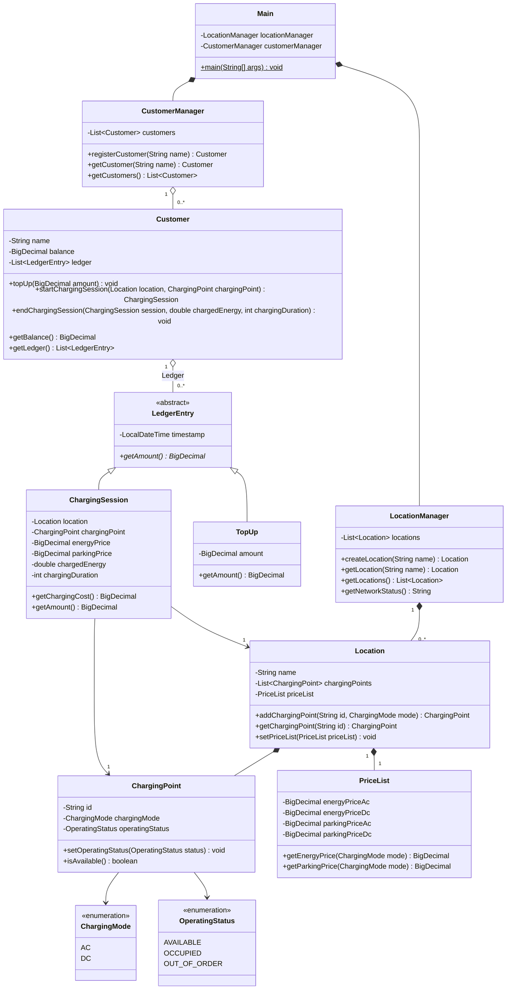

# Domain Model (MVP)

Minimal domain model for the MVP User Stories. Class names are Unique Terms from the [Glossary](../glossary.md).
Backlog stories (e.g. reservations, price history) extend the model later – keep this version for the FA10 reflection (original vs. actual).

## Notes

- **Customer Account** (glossary) = `balance` + `ledger` of `Customer`; no separate class needed.
- **Ledger** = the Customer's list of Top-ups and Charging Sessions in the order they happened (date-sorted).
- **Price List valid at the start applies:** `startChargingSession` copies the energy and parking price of the Location's Price List into the `ChargingSession`.
- **Charging Cost** = Charged Energy × energy price + Charging Duration × parking price; `endChargingSession` deducts it from the balance (C-13) and sets the Charging Point back to Available.
- **Network Status** (O-12, C-08) = `LocationManager.getNetworkStatus()`: Price List and Operating Status of every Charging Point per Location.
